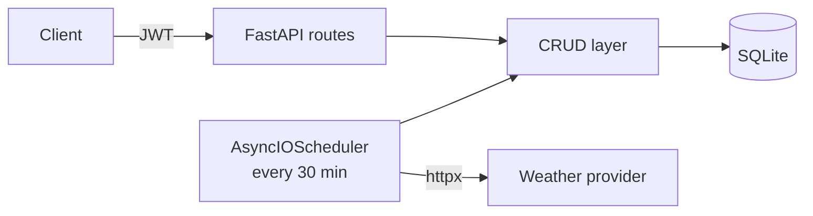

# Weather API

Async FastAPI service with JWT-protected user accounts and weather data
(current, 7-day history, forecast) cached in a local database.

🇷🇺 [Читать на русском](README.ru.md)


## Features

- **Auth:** registration, login, <bcrypt|argon2> password hashing, JWT access tokens
- **Per-user data isolation** on protected routes
- **Weather data:** current conditions, 7-day history and forecast from <provider name>
- **Background sync:** an `AsyncIOScheduler` job fetches fresh data every 30 minutes,
  validates and stores it, so user requests are served from the DB instead of
  hitting the external API each time
- **Validated I/O:** Pydantic schemas for all requests and responses

## Tech stack

Python · FastAPI · SQLAlchemy 2.0 (async) · SQLite · Pydantic · httpx · APScheduler · pytest

## Architecture



- `src/`: application code (routes, schemas, CRUD, scheduler)
- `tests/`: tests
- `requirements/`: dependency files

The CRUD layer keeps database logic out of the endpoints, and the scheduler
is the only component that calls the external weather API.

## Quick start

```bash
git clone https://github.com/yazmyrad/weatherApp.git
cd weatherApp
python -m venv .venv && source .venv/bin/activate   # Windows: .venv\Scripts\activate
pip install -r requirements/<base.txt>
cp .env.example .env        # then fill in the values below
uvicorn src.<module>:app --reload
```

Open http://localhost:8000/docs for the interactive API documentation.

### Configuration

| Variable | Description |
|---|---|
| `WEATHER_API_KEY` | API key for <provider name> |
| `SECRET_KEY` | Secret used to sign JWT tokens |
| `DATABASE_URL` | e.g. `sqlite+aiosqlite:///./weather.db` |

## Example usage

```bash
# register
curl -X POST http://localhost:8000/<register-route> \
  -H "Content-Type: application/json" \
  -d '{"username": "alice", "password": "secret"}'

# log in and get a token
curl -X POST http://localhost:8000/<login-route> ...

# get current weather (authorized)
curl http://localhost:8000/<weather-route>?city=Berlin \
  -H "Authorization: Bearer <token>"
```

```json
{
  "city": "Berlin",
  "temperature": 7.4,
  "description": "light rain",
  "updated_at": "2026-11-05T14:30:00Z"
}
```

## Tests

```bash
pip install -r requirements/<dev.txt>
pytest
```

## Roadmap

- [ ] Dockerfile + docker-compose
- [ ] PostgreSQL instead of SQLite
- [ ] CI with GitHub Actions
- [ ] Rate limiting on auth routes

## License

MIT
